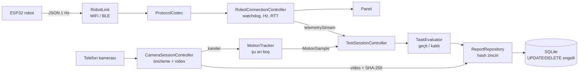

# Mimari ve Arayüz Planı

## 1. Kapsam (şartnameden uygulamaya düşenler)

Uygulama, şartnamedeki **Modül D – Mobil izleme ve değerlendirme** ile **Ö4 (20 puan)**
ölçütünü karşılar ve Ö1/Ö2/Ö3/Ö5 testlerinde ölçüm aracıdır.

| Şartname maddesi | Uygulamadaki karşılığı | Durum |
|---|---|---|
| Robotla kablosuz bağlantı, şarj + eğim 1 Hz | `connection` modülü, Panel | Hazır (robot verisi bekleniyor) |
| Bağlantı 2 s'den fazla kopmamalı | Watchdog + test kriteri "Bağlantı sürekliliği" | Hazır |
| Görev seçimi (Statik denge, Yönlendirme, Şarj, Bütünleşik) | `tasks` modülü, Test sekmesi | Hazır |
| "Testi Başlat" = başlangıç zaman damgası + kamera kaydı | `TestSessionController.start()` | Hazır |
| Canlı: hareket, yön, eğim, süre | Canlı test ekranı | Eğim/süre hazır; hareket/yön kamera tespitine bağlı |
| Hareket durumu (hareket, dönüş, statik, toparlanma) ve yön kameradan | `MotionTracker` arayüzü | **Boş** – yöntem ekipçe seçilecek |
| "Testi Bitir" veya otomatik bitiş koşulu | Görev başına `checkAutoStop` | Hazır |
| Otomatik geçti/kaldı (süre ±2 s, mesafe 0,8–1,2 m, yön, son konum, yük durumu) | `evaluators/` | Hazır; kamera kriterleri "Veri yok" |
| Video/zaman damgalı kayıt + değiştirilemez sonuç | SQLite + trigger + SHA-256 hash zinciri + video SHA-256 | Hazır |
| Şarj durumu: kamera + eğim + pil düzeyi | Şarj değerlendiricisi (telemetri hazır, kamera boş) | Kısmen |

## 2. Katmanlar

Her modül (feature) kendi içinde aynı dört katmana ayrılır:

```
presentation  → Sayfalar ve widget'lar (sadece gösterir, iş kuralı yok)
application   → Riverpod controller'ları (durum + akış yönetimi)
domain        → Saf Dart modelleri ve kurallar (Flutter'a bağımlı değil, test edilir)
data          → Dış dünya: WebSocket, BLE, kamera, SQLite, dosya
```

```
lib/
├── main.dart                     Platforma göre servis seçimi (SQLite / bellek)
├── app/                          Kök widget, tema, menü iskeleti
│   ├── app.dart
│   ├── app_shell.dart            Panel | Test | Kayıtlar | Bağlantı | Ayarlar
│   └── theme/                    Renk paleti, Material 3 tema
├── core/                         Ortak: sabitler, biçimlendirme, hash, ortak widget'lar
├── data/db/app_database.dart     drift tablo tanımı + değiştirilemezlik trigger'ları
└── features/
    ├── connection/               AĞ MODÜLÜ
    │   ├── domain/               RobotTelemetry, RobotMessage, RobotLink (arayüz), durum
    │   ├── data/                 ProtocolCodec, WifiWebSocketLink, BleUartLink
    │   ├── application/          RobotConnectionController (bağlan, watchdog, ping, yeniden bağlan)
    │   └── presentation/         Bağlantı sayfası, durum rozeti
    ├── dashboard/                Canlı telemetri paneli
    ├── camera/                   KAMERA MODÜLÜ
    │   ├── domain/               MotionTracker (arayüz), MotionSample, kalibrasyon
    │   ├── data/                 PlaceholderMotionTracker (boş), video saklama + SHA-256
    │   ├── application/          CameraSessionController (önizleme, kayıt)
    │   └── presentation/         Kamera önizleme paneli
    ├── tasks/                    TEST / DEĞERLENDİRME MODÜLÜ
    │   ├── domain/               TestTask, TestRecording, Evaluation, evaluators/
    │   ├── application/          TestSessionController, ReportPayloadBuilder
    │   └── presentation/         Görev seçimi, canlı test ekranı
    ├── reports/                  KAYIT MODÜLÜ
    │   ├── domain/               TestReport, ReportStore (ekle/oku arayüzü)
    │   ├── data/                 DriftReportStore (SQLite), ReportRepository (hash zinciri)
    │   └── presentation/         Kayıt listesi, rapor detayı
    └── settings/                 Ayarlar (bağlantı adresi, eşikler, tema, video)
```

## 3. Veri akışı



## 4. Servisler (Riverpod provider'ları)

| Provider | Görev | Değiştirmek için |
|---|---|---|
| `settingsProvider` | Ayarlar (SharedPreferences) | – |
| `robotLinkFactoryProvider` | Ayara göre WiFi / BLE bağlantı nesnesi | Yeni taşıma yolu eklemek |
| `robotConnectionProvider` | Bağlantı durumu, son telemetri, geçmiş, istatistik | – |
| `cameraSessionProvider` | Kamera önizleme ve video kaydı | – |
| `motionTrackerProvider` | Hareket tespit yöntemi | **Kamera yöntemi seçilince burası değişir** |
| `testSessionProvider` | Testin yaşam döngüsü | – |
| `reportStoreProvider` | Depolama (telefon: SQLite, web: bellek) | – |
| `reportRepositoryProvider` | Hash zinciri ile ekleme ve doğrulama | – |

Testlerde herhangi biri `ProviderScope(overrides: [...])` ile sahte nesneyle değiştirilebilir.

## 5. Veritabanı kararı: SQLite (drift)

| Ölçüt | SQLite (drift) | Supabase |
|---|---|---|
| Final alanında internet gerekir mi | Hayır | Evet |
| Tek telefon senaryosu | Tam uyumlu | Gereksiz karmaşıklık |
| "Kayıt değiştirilemez" | Trigger ile UPDATE/DELETE engeli + hash zinciri | RLS politikaları gerekir |
| Puan etkisi | Yok (şartname: yöntem puan getirmez) | Yok |

Değiştirilemezlik üç katmanlıdır:
1. Uygulamada güncelleme/silme kodu **yoktur** (`ReportStore` sadece `append` ve okuma içerir).
2. SQLite trigger'ları `UPDATE` ve `DELETE`'i reddeder.
3. Her rapor `hash = SHA-256(önceki_hash + kanonik zarf)` ile zincirlenir; zarf tüm
   sütunları (sıra, test no, görev, sonuç, zamanlar) ve rapor içeriğini kapsar. Dosya dışarıdan
   değiştirilse bile (sadece "sonuç" sütunu dahi) **Kayıtlar** ve **Ayarlar > Veri > Doğrula** bozuk kaydı gösterir.
   Videonun SHA-256'sı da rapora yazılır.

İleride: rapor JSON dışa aktarma hazır; PDF dışa aktarma ve isteğe bağlı bulut yedeği
eklenebilir (`ReportStore` arayüzüne yeni bir implementasyon).

## 6. Kamera modülü planı

Şu an çalışan: kamera önizleme, "Testi Başlat" ile video kaydı, "Testi Bitir" ile kaydın
uygulama klasörüne taşınması ve SHA-256 özeti.

Ekip kararını bekleyen: **hareket/yön/mesafe tespiti**. Seçilen yöntem şu arayüzü uygular:

```dart
abstract class MotionTracker {
  String get name;              // "Renkli işaretçi", "ArUco" ...
  bool get isImplemented;       // true
  bool get needsFrames;         // true -> kayıt sırasında kareler gelir
  Stream<MotionSample> get samples;
  Future<void> start();         // test başı: konum (0,0)
  void processFrame(CameraImage image);
  Future<void> stop();
  Future<void> dispose();
}
```

`MotionSample`: zaman, konum `x/y` (metre), yön açısı, hareket durumu
(`stationary/moving/turning/recovering`), yön (`forward/backward/left/right`),
`atStation`, `boxVisible`. Değerlendiriciler bu örneklerden mesafe, baskın yön, son konum,
hedefte bekleme ve kutu durumunu hesaplar (`MotionTrackSummary`). Yeni tracker yazılıp
`motionTrackerProvider`'a verildiğinde **başka hiçbir dosya değişmez**.

Seçenekler (ekip için not):
- Renkli işaretçi + HSV eşikleme (saf Dart, en basit; bilinen 1 m ile kalibrasyon).
- ArUco/AprilTag (OpenCV eklentisi; yön açısı doğrudan çıkar, daha hassas).
- ML Kit nesne tespiti (işaretçisiz; mesafe hassasiyeti düşük).

Not: `startVideoRecording(onAvailable:)` ile kayıt sırasında kare almak bazı Android
cihazlarda sınırlı olabilir; yöntem seçildiğinde hedef telefonda denenmeli.

## 7. Değerlendirme kuralları

Karar: zorunlu kriterlerden biri **sağlanmadıysa KALDI**; hiçbiri sağlanmamış değil ama
biri **ölçülemediyse EKSİK VERİ** (puanlamada kaldı sayılır); hepsi sağlandıysa **GEÇTİ**.
"(bilgi)" işaretli kriterler kararı etkilemez. Eşikler Ayarlar'dan değiştirilebilir ve her
rapora o anki eşikler de yazılır.

| Görev | Zorunlu kriterler | Otomatik bitiş |
|---|---|---|
| A Statik denge | Dengede kalma ≥ 30 s (±2 s), düşme yok, bağlantı boşluğu ≤ 2 s | 31. s veya düşme |
| B Yönlendirme | Kamera yönü = beklenen; ileri/geri: mesafe 0,8–1,2 m; dönüş: 90° ± 30°; düşme yok; bağlantı | Kamera: hareket + 3 s durma; 60 s |
| C Şarj | Yerleşme → şarj başlangıcı ≤ 5 s (`docked` veya kamera `atStation`, `charging`); bağlantı | Şarjdan 2 s sonra; 60 s |
| E Bütünleşik | Başta 5 s denge, ≥ 0,8 m hareket, kutu düşmedi, hedefte ≥ 5 s, şarj ≤ 5 s, düşme yok, bağlantı | Şarjdan 2 s sonra; 300 s |

Ekiple netleştirilecek açık noktalar:
- Ö2'de ileri/geri 0,5 m geçerken uygulama tablosunda 0,8–1,2 m yazıyor. Varsayılan
  0,8–1,2 m; jüri farklı isterse Ayarlar'dan değiştirilir.
- Robot `docked` ve `box_present` gönderebilecek mi? Gönderirse şarj ve kutu kriterleri
  kamerasız da ölçülür.

## 8. Arayüz planı

Tasarım ilkeleri: sade, okunur, veri yoğun; emoji ve uzun açıklama yok. Sayılar sabit
genişlikli rakamlarla, Türkçe ondalık virgülle gösterilir. Verisi olmayan alan **"—"**
ve gri renkle görünür.

Renkler (renk teorisi: analog mavi–turkuaz + tamamlayıcı mercan yalnız hata için):

| Rol | Açık tema | Koyu tema |
|---|---|---|
| Ana (grimsi mavi) | `#3E5C76` | `#8DB0CF` |
| İkincil (turkuaz) | `#1A9E9E` | `#4FC9C4` |
| Arka plan | `#F3F6F8` | `#10171D` |
| Geçti | `#1F8F7A` | `#1F8F7A` |
| Kaldı / hata | `#C8553D` | `#C8553D` |
| Eksik veri / uyarı | `#D9A441` | `#D9A441` |

Menü (telefonda alt gezinme, tablet/web'de yan menü):

| Modül | İçerik |
|---|---|
| **Panel** | Şarj %, gerilim, eğim, şarj durumu, istasyon, robot durumu, kutu, IR, son eldiven komutu; eğim göstergesi + 2 dk eğim/pil grafiği; ham telemetri |
| **Test** | Ön koşullar; 4 görev kartı (modül harfi, ölçüt, puan satırı); yönlendirmede beklenen yön seçimi |
| Canlı test | Kamera önizleme + KAYIT etiketi + sayaç; süre, şarj, eğim, şarj durumu, hareket, yön, konum, robot durumu; Testi Başlat / Testi Bitir |
| **Kayıtlar** | Bütünlük durumu; görev bazında toplam/geçti/kaldı/eksik; filtre; rapor listesi |
| Rapor detayı | Sonuç bandı, test bilgisi, kriter tablosu (beklenen/ölçülen/kaynak), ölçülen değerler, video SHA-256, telemetri tablosu, hash bilgisi; JSON kopyala/kaydet |
| **Bağlantı** | Wi-Fi / BLE seçimi, adres, hazır ayarlar (ESP32, Simülatör), bağlan/kes, kalite tablosu (Hz, son veri, en uzun boşluk, RTT), olay günlüğü, bağlanma adımları |
| **Ayarlar** | Tema, video kaydı, kamera yöntemi/kalibrasyon, değerlendirme eşikleri, veri bütünlüğü doğrulama, sürüm |

## 9. Yeni bir şey eklemek

| İstek | Yapılacak |
|---|---|
| Robot yeni bir sensör alanı gönderiyor | `RobotTelemetry`'ye alan + `fromJson/toJson`, Panel'e bir `MetricTile` |
| Kamera tespit yöntemi | `MotionTracker` uygulayan sınıf + `motionTrackerProvider` |
| Yeni görev | `TestTask`'a değer + `TaskEvaluator` sınıfı + `forTask` eşlemesi |
| Yeni bağlantı yolu (örn. USB seri) | `RobotLink` uygulayan sınıf + `TransportKind` + `robotLinkFactoryProvider` |
| PDF rapor | `report_detail_page.dart`'taki TODO; `pdf` paketi |
